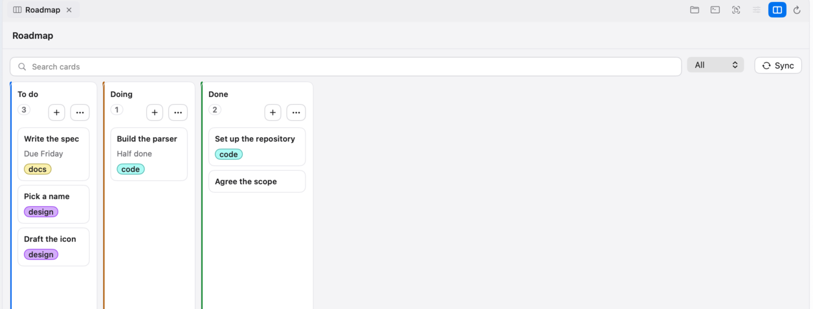
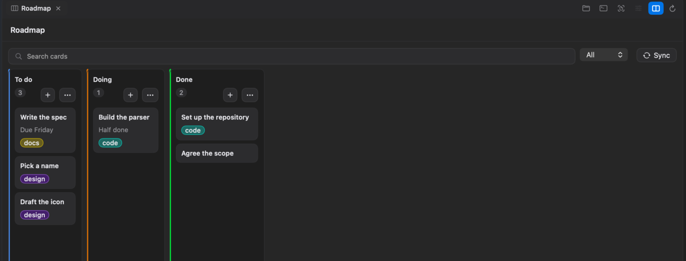
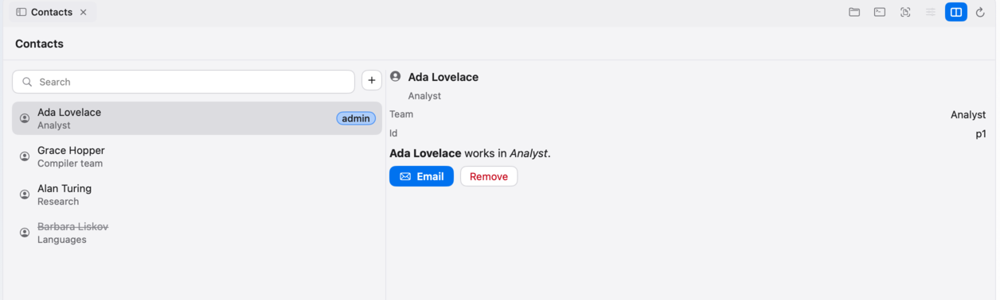
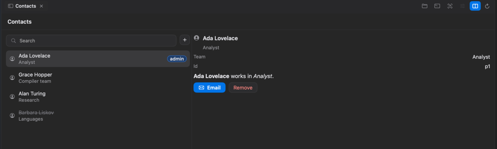
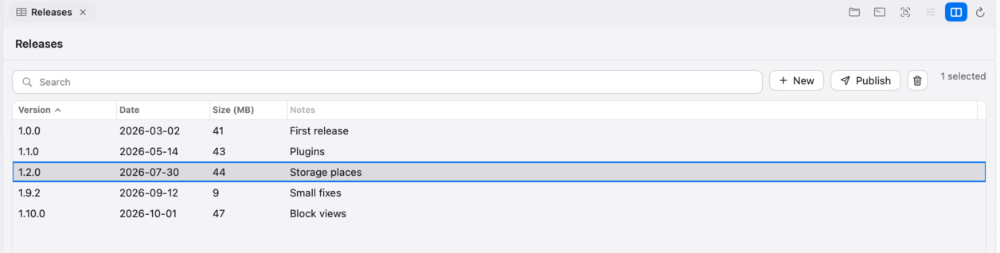
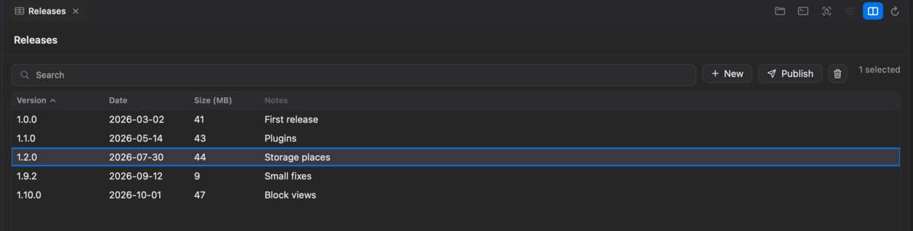
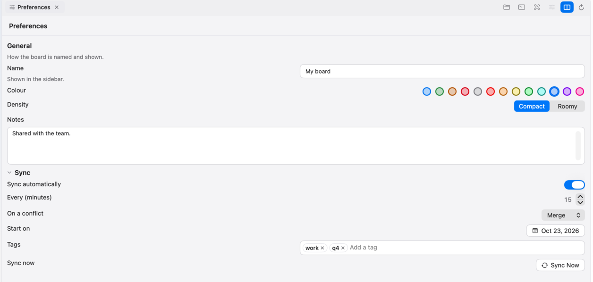
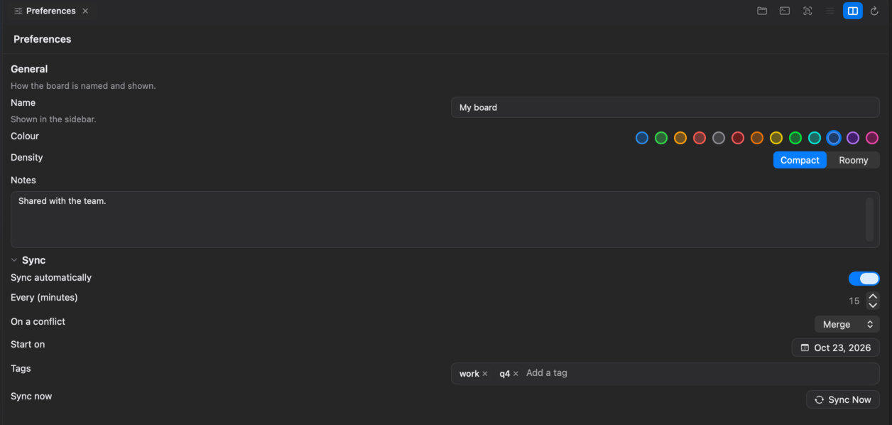
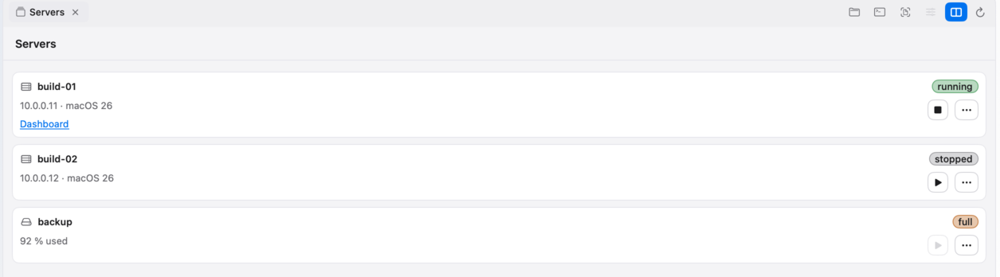
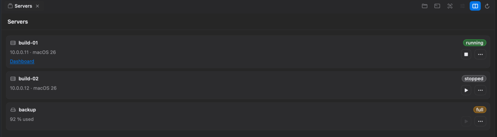

# Layouts: a board, a list with detail, a table, a form, a card list

The Swift and Node SDKs ship five **layouts**: ready-made compositions of [blocks](reference.md#block-views-api-2) for the screens
plugins build most often. A layout is not a new kind of block and Vektor knows nothing about it; it is a function (or a small type)
that returns blocks, plus a second function that sends the events those blocks cause to typed callbacks. Their source is short,
documented and **meant to be copied into your plugin and changed** — the way to use a layout you almost like is to copy its file.

| Layout | For | Node.js | Swift |
|---|---|---|---|
| [Board](#board) | cards in columns that move between them (a kanban board) | `board`, `routeBoard`, `moveCard` | `Board` |
| [List with detail](#list-with-detail) | a searchable list, the chosen item beside it | `listDetail`, `detailPanel`, `routeListDetail` | `ListDetail`, `DetailPanel` |
| [Table with toolbar](#table-with-toolbar) | sortable columns, several rows selected, buttons above | `tableWithToolbar`, `sortRows`, `routeTable` | `TableWithToolbar`, `TableRow.sorted` |
| [Settings form](#settings-form) | sections of labelled fields | `settingsForm`, `routeSettingsForm` | `SettingsForm` |
| [Card list](#card-list) | a column of cards with a pill, lines, buttons, a menu (the look of the `cardList` view kind) | `cardList`, `routeCardList` | `CardList` |

How to call them is in [`sdk-node.md`](sdk-node.md#layouts) and [`sdk-swift.md`](sdk-swift.md#layouts); this page says what each
one is, what it draws and which events it gives you.

## How a layout works

Every layout is two calls, one to **draw** and one to **listen**:

1. **Draw**: you give it your data (columns of cards, rows, fields …) and it returns one block. You describe the view with it, as
   with any other block: `view.show(…)`. The SDK sends a patch when it can, so a card that moved is one `move` operation, not the
   whole board again.
2. **Listen**: you call the layout's `route…` function **once**, when you set the view up, with an object of callbacks
   (`onMove`, `onAdd`, `onSort` …). It registers the actions the layout drew and turns a raw `view/event` into the thing you care
   about: the column and the card, not a block id.

You keep the data. A layout never remembers anything: when `onMove` fires you change **your** data, draw again, and the
difference reaches Vektor. (Vektor shows a move only when your next description says so; that is the reference's rule, not the
layout's.)

**Names.** Every block id and every action a layout makes starts with the layout's `id` (`board`, `table` … or your own, if
you put two of one kind in a view): `board.add.todo` is the "+" of the column `todo`, `table.sort` is the table's sort action.
Cards, rows and items keep **your** ids, unchanged, because Vektor and the SDK diff by id — a card's id is the card's, never its
position. Ids that contain dots are fine.

**Colours** are roles (`label1` … `label8`, `accent`, `positive` …), never values; see the reference. Every state the layouts
show is also in words: a count says "3 of 5", not just a colour.

**Keyboard.** The layouts add none of their own. The list-like blocks inside them carry Vektor's: arrows move the focus,
⌥ + an arrow moves a card (the board's `onMove` fires exactly as for a drag), Return opens, ⌫ deletes where the layout offers it.

## When to use blocks, and when a web view

**Prefer blocks.** Vektor draws them natively, so the theme, the keys, VoiceOver and the rule that nothing acts behind a dialog
are right without your doing anything. A layout is still blocks.

| You want | Use |
|---|---|
| Lists, tables, boards, forms, cards, tabs, split views, a detail pane, inputs, menus, progress | **Blocks** (a layout, or your own composition) |
| Something that must feel native to Vektor: keyboard focus across lists, drag of cards, context menus, Quick Look-style file lists | **Blocks** |
| A canvas, a diagram or graph editor, a chart, a code editor, pixels you draw yourself | **A web view** (`samples/sketch`) |
| An existing web UI you do not want to rewrite | **A web view** |
| A mix: native toolbar above, a canvas below | **Both**: a `web` block inside a block view |

A web view is a sandboxed page of your own files with no network, one bridge to your plugin (`vektor.post`) and the theme as CSS
properties. It costs a process per page, its keys are the page's, and VoiceOver reads what you write in HTML. Everything about
it is in the reference ([Web views](reference.md#web-views-api-2)); the SDKs have the plugin side (`plugin.web(view)`) and
`sdk/web/` the page side (a bridge and a starter stylesheet).

## Board

Columns of cards. Each column has a **title**, a **count** of the cards shown, a **"+"** button and a **"…"** menu. Cards can be
dragged between columns and moved with ⌥ + an arrow. Above the columns: a **search** field, an optional **filter** (a picker
over the cards' tags) and a **toolbar slot** for your own blocks (a Sync button, "New column" …).

You give it: the columns (`id`, `title`, an optional colour `role`, and cards: `id`, `title`, optional `subtitle`, `role`, `tags`),
the search text, the filter (`options` and the chosen value), your toolbar blocks, what the column menu offers (default:
rename, delete) and, optionally, a **column minimum width** (`columnMinWidth`, points from 20 to 4000): the columns then fill the
pane, sharing its width, and scroll sideways once they would be narrower than that. Without it a column is as wide as its widest
card.

| Callback | When | You get |
|---|---|---|
| `onAdd` | the "+" of a column | the column id |
| `onOpen` | "Open" in a card's context menu (Return and a double-click edit the title: Vektor gives `edit` precedence) | the card id |
| `onRename` | the card's title edited in place | the card id, the new title |
| `onRemove` | ⌫ on a card | the card id |
| `onMove` | a card dropped, or ⌥ + arrow | `{ card, from, to, index }` — column ids; `index` counts the cards **shown** in `to` |
| `onColumnAction` | an entry of a column's "…" menu | the column id, the entry's key |
| `onSearch`, `onFilter` | the search field committed; the filter changed | the text / the value |

The layout hides cards that do not match the search or the filter (title, subtitle or a tag contain the text) and says so in the
count ("2 of 5"). The filter's "All" option has the value `''` in your data and in `onFilter`; Vektor refuses an option with an
empty value, so on the wire the layout sends `board.all` (with your `id` as the prefix) in its place and turns it back into `''`. `moveCard` (Node) / `Board.apply` (Swift) applies an `onMove` to your columns the way a person expects when
some cards are hidden: `index` counts shown cards only, and the hidden ones keep their place.

## List with detail

A split view with a draggable divider: on the left a **search field** (and your toolbar blocks) over a list of items with
single selection; on the right whatever **you** put there for the chosen item, or an empty state when nothing is chosen.
`detailPanel` / `DetailPanel` builds the usual right side — a heading with symbol and subtitle, label/value rows, Markdown and a row
of buttons — as blocks you can put there or replace.

| Callback | When | You get |
|---|---|---|
| `onSelect` | the chosen item changed | the item id, or none |
| `onOpen` | Return or a double-click | the item id |
| `onSearch` | the search committed | the text |
| `onDetailAction` | a button of `detailPanel` | the button's key |

Items are `id`, `title`, optional `subtitle`, `symbol`, `badge`, `dimmed`. Search matches title and subtitle.

## Table with toolbar

A toolbar above a table: a **search field**, your **buttons** (some can be disabled until something is selected), and "N selected"
in words. The table has **sortable columns** and **multiple selection**; Return or a double-click opens a row and ⌫ deletes it
(you decide whether to ask first).

| Callback | When | You get |
|---|---|---|
| `onSort` | a sortable column's header was clicked | the column id, whether ascending |
| `onSelect` | the selection changed | the selected row ids |
| `onToolbar` | a toolbar button | its key and the selection the user sees: the one heard last, less rows no longer shown |
| `onSearch` | the search committed | the text |
| `onOpen`, `onDelete` | Return / double-click; ⌫ on a row | the row id |

**Vektor does not sort for you.** It draws the arrow and tells you the column and direction; you sort your rows
(`sortRows` / `TableRow.sorted` orders numbers as numbers and text naturally, stably) and draw again. The same for the selection:
keep what `onSelect` gave you and pass it back as `selected`, which drives the "N selected" text and the buttons that need a
selection, and is sent as the table's `selected`, which Vektor starts from when it has no selection of its own (the first time,
and after the view is reopened).

**Only shown rows stay selected.** Vektor keeps only the selected rows that are still described and says nothing (no `select`
event) when a search or a removal drops one. The layout does the same: rows you pass in `selected` that are not shown are left out
of the count, the buttons and `selected`, and `onToolbar` reports only rows the table still has. After the view is reopened,
`onToolbar` reports what the table was described with until the user selects again.

## Settings form

Sections of **fields**, the way a preferences page reads: the label (and a line of help) on the left, the control on the right;
a text area puts its label above it. Sections can fold. Field kinds: text, text area, toggle, picker (menu or segmented),
stepper, date, tags, colour role, and a button on its own line.

| Callback | When | You get |
|---|---|---|
| `onChange` | any field changed | the field's key, the new value (text, true/false, a number, `yyyy-MM-dd`, a list of tags, a role) |
| `onButton` | a button field pressed | the field's key |

A field shows the `value` you give it, so a value you refuse simply snaps back; `error` writes the reason under it. A change
that arrives against an older description is still delivered (text typed quickly must not be lost). This is a form **inside a
view**; settings that belong on Vektor's own Settings page are declared in the manifest, where Vektor draws them, stores them and
keeps secrets in the keychain — use a manifest setting whenever it will do.

## Card list

The look of the `cardList` view kind, built from blocks: a column of cards, each with a **symbol**, a **title**, a **pill**,
**lines** of text (one can be a link), **buttons** at the right, a **"…" menu** and a context menu with the same entries. With no
cards it shows an empty state.

| Callback | When | You get |
|---|---|---|
| `onOpen` | Return or a double-click on a card that is `openable` | the card id |
| `onButton` | one of a card's buttons | the card id, the button's key |
| `onMenu` | an entry of a card's menu | the card id, the entry's key |

Give `routeCardList` the `menuKeys` of every menu entry any card can have: an action is routed by its exact text, so each one is
registered. A button's `key` is a word without dots (`open-url`, not `open.url`): the button's id is the key followed by the card's
id, which may contain dots, so drawing refuses such a key with a `PluginError` rather than send a button whose events reach the
wrong card.

## What the reference does not say (and what the layouts rely on)

The layouts follow [`reference.md`](reference.md). Where it is silent, they rely on what Vektor does, checked against Vektor
itself, and say so here:

* **`selected` on a list or table is the initial selection only.** The reference has `select` (the event) but does not say what
  a `selected` field does. Vektor reads it as the selection to start from when it has none of its own: the first time, after
  the view is reopened, and after the selected rows were all removed or hidden. It never overrides a selection the user made.
  The table sends the shown rows of your `selected`; the list with detail sends the chosen item while it is shown. Vektor keeps
  only selected rows that are still described, silently (no `select` event).
* **`selection` and `select` on a `table` work.** The reference lists them for `list`; the table's own row names only
  `columns`, `sorted` and `sort`. Vektor reads them on a table too, and the table layout sends them.
* **A menu item's event names the block that carries the menu**: the column's "…" block, the card with a context menu. The
  layouts read the column or card from it.
* **A `menu` block's `symbol` is drawn only on a titled menu.** The "…" menus the layouts draw have no title, so they send no
  symbol.
* **`edit` takes precedence over `action`.** On an item with both, Return and a double-click edit the title and the `action`
  is never sent. That is why a board card, whose title can be renamed in place, opens from its context menu.
* **`spacing` on a `list`.** The reference lists `spacing` for stacks and grids only; Vektor reads it on a list too, and the
  card list uses it to keep its cards apart. The card list is a `list` (not a stack in a scroll) because only the items of a
  collection get Return and a double-click.
* **`index` and hidden cards.** A move's `index` is the position among the items Vektor shows; with a search or filter on, those
  are only the matching cards. `moveCard` / `Board.apply` accounts for it.

## What Vektor does that a layout cannot change

These are Vektor's own behaviour today; a layout can only work around them, and they are reported to Vektor's maintainers:

* **The arrow keys change a list's selection without sending `select`.** In the list with detail, moving with ↑ and ↓ highlights
  another item but `onSelect` does not fire, so the right side keeps showing the item last clicked until the user clicks.
* **A click on a table row ignores ⌘.** Several rows are selected only with Space (and the arrows); ⌘-click selects just the
  clicked row.
* **⌫ on a table deletes only the focused row.** `onDelete` fires once, for the row that has the keyboard focus, even when several
  rows are selected. For "delete the selection", offer a toolbar button: `onToolbar` gives you every selected row.
* **A `card` with `edit` cannot be renamed in place.** Vektor draws the in-place editor for a `row` (and a tree `node`) only:
  Return on a focused board card starts an edit that is never shown, so `onRename` does not fire from the board as drawn today
  (the reference's own example puts `edit` on a card). Until Vektor draws it, rename a card from a dialog (`plugin.showDialog`)
  opened by "Open" or by a menu entry of your own.
* **A board column is as wide as its widest card** unless the board sets `columnMinWidth`: blocks take widths since plugin API 2's
  widths (`width`, `minWidth`, `maxWidth`, `grow`; see the reference), and with it the columns grow to fill the pane and scroll
  once they no longer fit.
* **Checked in a real Vektor (plugin API 2), light and dark:** every callback above fired from the keyboard, a click, a
  context menu or a "…" menu, except a card dragged with the mouse (synthetic mouse events cannot start a drag; ⌥ + an arrow
  sends the same event and did move cards) and the board's `onRename` (above).
